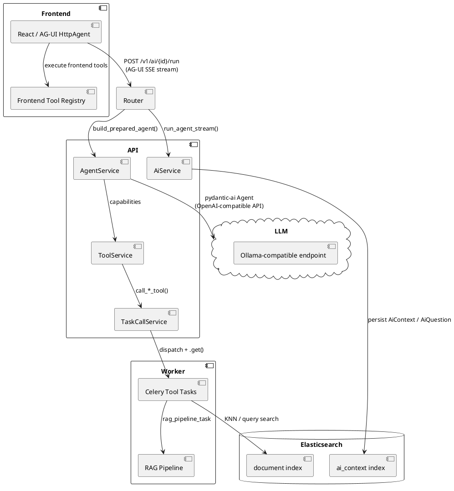
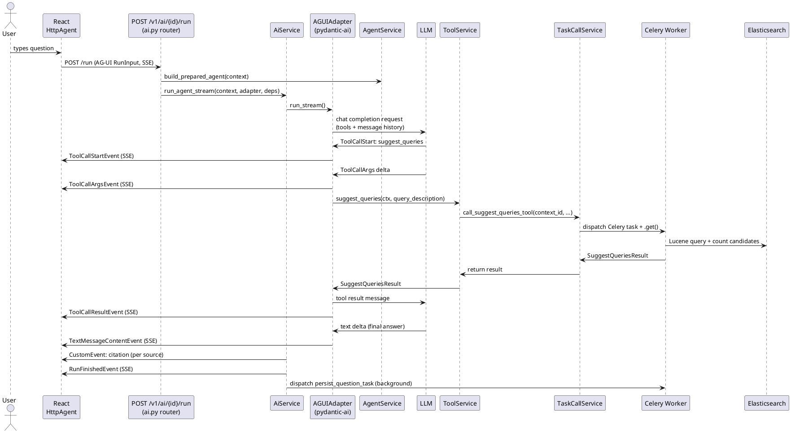
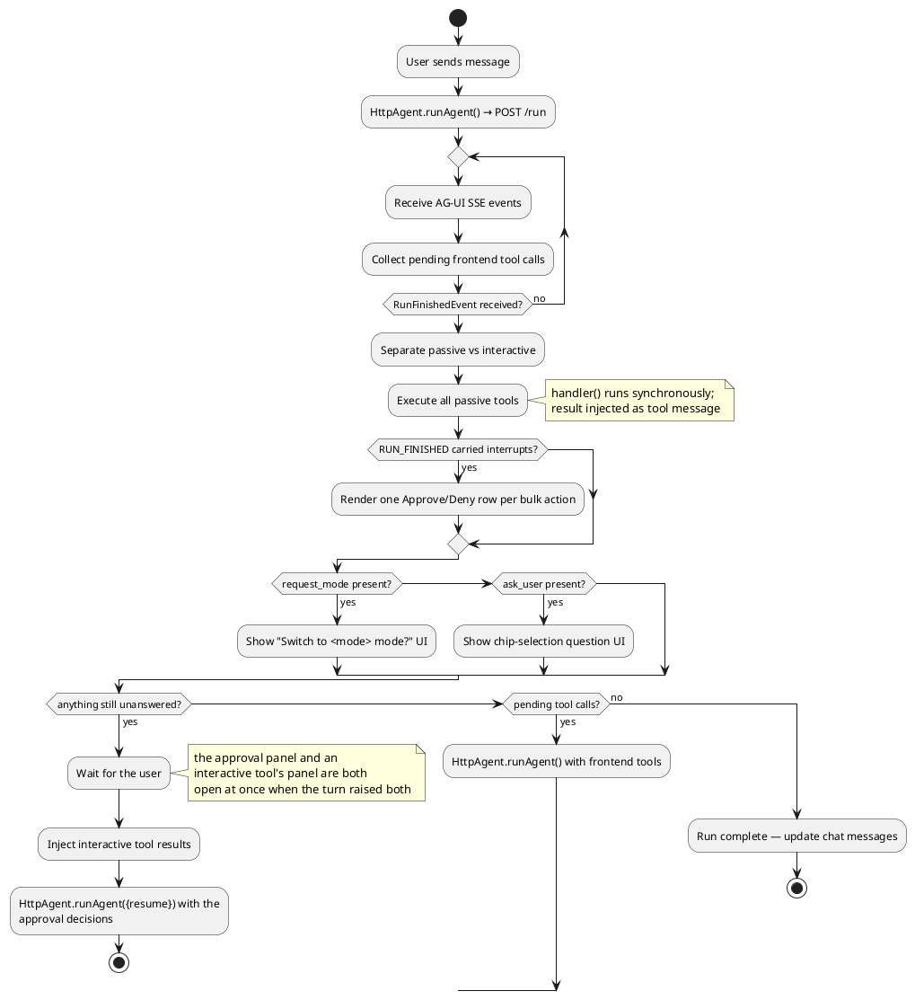
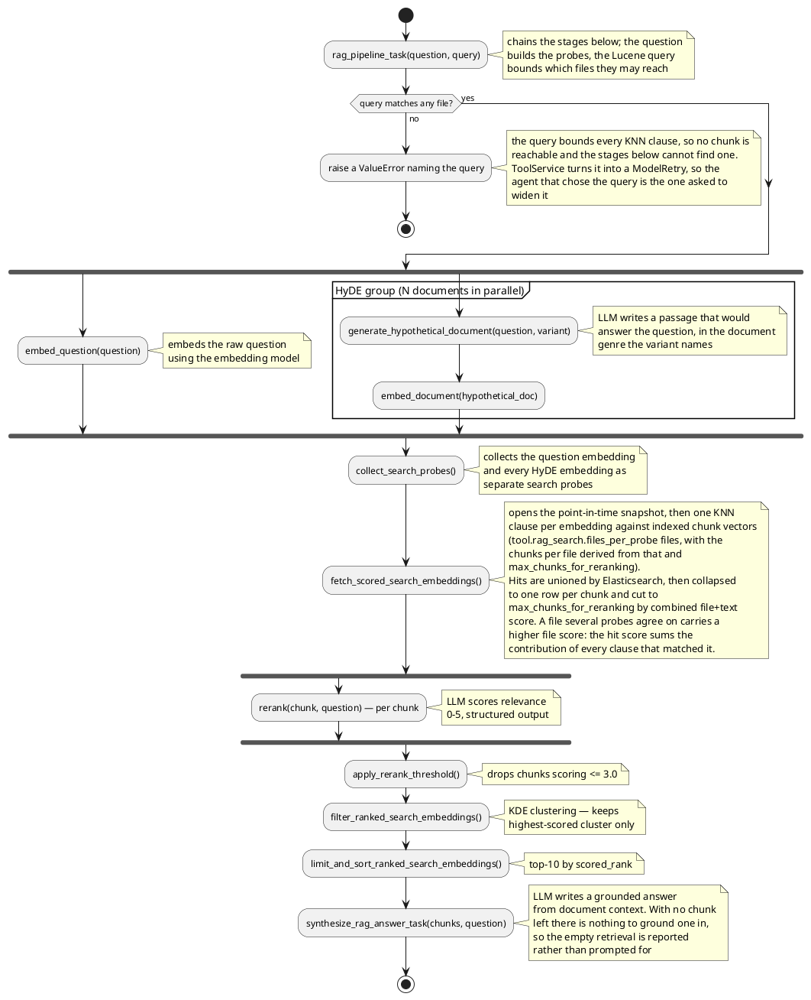

# AI Chatbot Architecture

Loom's AI chatbot lets users explore their indexed document corpus through natural language. Instead of
writing Lucene query strings by hand, users ask questions and the agent translates intent into search
actions, reads documents, manipulates the search UI, and synthesizes answers grounded in the corpus.

Tools are organised into **capabilities** — groups of related tools that the agent loads together.
Which capabilities a conversation has is decided by its mode:

| Capability | `chat` | `work` | `research` | Carries |
| ---------- | :----: | :----: | :--------: | ------- |
| `search_and_browse` | | ✓ | ✓ | Compose a query, run it, search by filename, browse folders, read one file's fields |
| `enrichment` | | ✓ | | Everything that changes a file, for one file or for every file a query matches |
| `ui_interaction` | | ✓ | | Read and drive the search UI |
| `research` | | | ✓ | `rag_search`, which answers a question across the corpus in one call |

`enrichment` is work-mode only because research composes its own queries across the whole corpus
with no user in the loop, and `research` is research-mode only because `rag_search` returns a
conclusion rather than a result set — the one read with nothing to show on screen. Everything else
is shared, so research is `work` with the acting removed.

Three tools in `search_and_browse` behave differently by mode: in `work`, `execute_query` also
applies its query to the user's results list, and `get_file` and `get_file_field` both highlight the
file they read, so what the agent reads is what the user is looking at. In `research` all three run
with no effect on any screen. Because a capability's `description` and `instructions` are the only
place the agent can be told so, the bundle is built twice — once per mode — with the same tools and
different instructions.

---

## Architecture Overview



---

## Key Concepts

### AiContext

`AiContext` is the persistent container for a conversation. It is stored in the `ai_context`
Elasticsearch index and holds:

- **`questions`** (`list[AiQuestion]`) — the accumulated Q&A history. Each `AiQuestion` stores the
  question text, the agent's answer, `citations` (referenced file IDs with text snippets), and an
  `activity` list — an ordered record of `ToolCallActivityEntry` (name, inputs, output for each
  backend tool invocation) and `ReasoningActivityEntry` (LLM thinking traces) items.
- **`active_mode`** (`ModeId`) — the conversation's mode, one of `chat`, `work` and `research`. It
  is what decides which capabilities the agent is offered; see
  [Agent and Tools](#agent-and-tools).

A new context is created per conversation via `POST /v1/ai`. The frontend fetches its history on
load via `GET /v1/ai/{context_id}/history`.

### Agent and Tools

`AgentService` wraps a single pydantic-ai `Agent` configured with an OpenAI-compatible LLM (served
by Ollama or a compatible endpoint). It is the only client whose prompt carries more than one system
message, so it is the only one affected by the merging the self-hosted providers ask for (see
[System message merging](#system-message-merging)). `AgentService.build_prepared_agent` asks
`ToolService.capabilities_for_mode(context.active_mode)` which `Capability` groups the run is
offered: `_WORK_CAPABILITIES` for `work`, `_RESEARCH_CAPABILITIES` for `research`, and nothing at
all for `chat`. Every group is declared `defer_loading=True`, so no run starts with a tool in hand:
the agent reads the descriptions and loads the bundles it needs rather than carrying every tool in
every prompt.

`enrichment` is assembled across both tool services. `ToolService` owns the per-file tools and
`BulkToolService` exposes its five `bulk_*` tools as a plain list, because one bundle needs both
halves and a `Capability` can only be built where both are in reach.

Tools are split into two tiers:

- **Backend tools** — Python functions in `ToolService` that call `TaskCallService`, which
  dispatches a Celery task synchronously and returns a typed result model. The call is bounded by
  `settings.llm.agent.tool_timeout` (600s), which pydantic-ai applies to the tool; Celery's
  `.get()` is not given a timeout of its own.
- **Frontend tools** — TypeScript functions registered in the React frontend. The agent declares
  them as deferred tools; the frontend executes them after each agent run and re-submits results.

### Provider

> ℹ️ This section is why each provider differs. For pointing a deployment at one — which
> values to set, and on which client — see
> [External services](external-services.md#inference-endpoints-outside-the-cluster).
> It does not apply to the system-one clients; see [System one models](#system-one-models).

Pointing a client at an endpoint takes one setting beyond the endpoint and the model name:

| Setting                 | Answers                             | Values                                                |
| ----------------------- | ----------------------------------- | ----------------------------------------------------- |
| `llm.<client>.provider` | Which service answers at `endpoint` | `ollama` (default), `litellm`, `infomaniak`, `openai` |

**`provider`** is pydantic-ai's term for the class handling authentication and the connection to one
LLM service — one class per service, so one setting value per service. It is an enum: an unrecognised
value fails at startup with the accepted options listed, rather than being silently ignored.

The model class is always `OpenAIChatModel`; per pydantic-ai's guidance, an OpenAI-compatible API needs
a custom *provider*, not a custom model class, and `common/llm/provider.py` is where each service's
quirks live:

| Value        | Class                 | Why it is not the stock one                                                                                                                                                                                                    |
| ------------ | --------------------- | ------------------------------------------------------------------------------------------------------------------------------------------------------------------------------------------------------------------------------ |
| `ollama`     | `LoomOllamaProvider`  | Matches the family off the re-uploaded name (below). Also withholds `max_completion_tokens`, which Ollama's request struct does not have, and claims `supports_thinking`.                                                      |
| `litellm`    | `LoomLiteLLMProvider` | Upstream reads the family from a `vendor/model` prefix; fronting vLLM, the served name carries none. Matches it off the name instead, and claims `supports_thinking`.                                                          |
| `infomaniak` | `InfomaniakProvider`  | Serves open-weight models under short slugs, and answers `422 validation_failed` for request fields it does not know — so `max_completion_tokens` is withheld. Claims `supports_thinking`, which was measured against the API. |
| `openai`     | `OpenAIProvider`      | Stock. The one service whose own table knows its models, per model.                                                                                                                                                            |

#### Model families

A model family carries the request-construction rules for the weights — above all
`json_schema_transformer`, which decides how JSON schemas are serialised for structured-output calls
(`$defs` inlined rather than referenced). Getting it wrong surfaces as the model failing to produce
parseable output, not as an error.

pydantic-ai infers the family from the model name by prefix, which misses two cases Loom hits:
community re-uploads published under an author namespace (`huihui_ai/qwen3.5-abliterated:9b` matches
nothing), and services whose own lookup table does not cover open weights at all. `_family_profile()`
in `common/llm/provider.py` closes both — it drops the namespace, lowercases, and prefix-matches
`llama`, `gemma`, `qwen`, `qwq`, `deepseek`, `mistral`, `mixtral` and `gpt-oss` — and every provider
above except `openai` layers it in.

There is no `family` setting: the name in `llm.<client>.model` is the claim. On LiteLLM/vLLM, where
the served name is whatever the operator configured, **name the deployment after the weights** — a
model served as `prod-deployment-1` matches nothing and gets no family rules.

#### How the profile is layered

Each provider's `model_profile` merges its own layers, lowest first:

1. **Upstream's provider profile** — what the service accepts.
2. **The family** — above the provider because it describes the *model*, and every provider claims
    `json_schema_transformer` unconditionally; a generic OpenAI transformer applied to Qwen breaks
    structured output.
3. **Loom's claims** — `supports_thinking` for services where no lookup table recognises the model
    name. Above the family because gemma and gpt-oss both set `supports_thinking=False`, which from any
    lower layer would strip `thinking` from every request again (#307). That `False` is not knowledge
    about the weights: gemma gets it from Google's `'gemini-2.5' in model_name` test and gpt-oss from
    OpenAI's reasoning table, both of which only ever recognise that vendor's hosted models.

4. **System message merging** — for the services that execute an open-weight chat template.
5. **The parameter floor** — `default_structured_output_mode: native` for a model whose name states a
    size below 4B. Topmost because a provider-level `default_structured_output_mode` (upstream sets one
    for Snowflake) describes a vendor's API rather than the size of the checkpoint being served.

The model is built with no `profile=` argument at all: every layer is a fact about the service or
about the weights, and the provider is where both are known.

#### System message merging

`LoomOllamaProvider`, `LoomLiteLLMProvider` and `InfomaniakProvider` set
`openai_chat_supports_multiple_system_messages=False` and `supports_inline_system_prompts=False`,
which merge consecutive leading system messages into one and demote the ones that follow (e.g.
tool-availability announcements after `load_capability`) to user-role text.

This is required when the model's chat template accepts only a single leading system message and the
service executes that template — vLLM behind LiteLLM, rendering Qwen's template, answers `System
message must be at the beginning` as soon as a capability's instructions add a second
`InstructionPart`. Ollama and Infomaniak run the same family of templates, so they claim it too;
where it is not needed it costs nothing, being a no-op on the single leading instruction every client
except `llm.agent` sends. `OpenAIProvider` does not claim it: the API takes repeated system messages
at full weight, and demoting them would weaken instructions for no reason.

There is no setting. Whether a service accepts more than one system message is a property of that
service, not something an operator chooses.

#### Structured output

Clients whose agent returns a model rather than a string — summarization, translation, vision,
`suggest_queries`, `language_detection` — need the answer to arrive in a shape that can
be validated. pydantic-ai offers two channels for that, and `common/llm/provider.py` picks between
them from the model name:

| Model | Mode | Where |
| ----- | ---- | ----- |
| `qwen3.8:27b` | `tool` | production default |
| `qwen2.5:0.5b`, `moondream:1.8b` | `native` | `values-development.yaml` |
| `Qwen/Qwen3.5-122B-A10B-FP8`, `mixtral:8x7b`, `prod-deployment-1` | `tool` | no size stated |

**Tool output** (pydantic-ai's default) asks the model to answer with a well-formed call to an output
tool, emitted from its own chat template. Nothing between the sampler and the parser checks the
shape, so it is only as good as the weights. **Native output** compiles the JSON schema into a
grammar and decodes under it — llama.cpp behind Ollama, XGrammar behind the vLLM LiteLLM fronts — so
the schema holds whatever the model would rather have said.

`_structured_output_profile()` claims native below a 4B parameter floor, read off the `:0.5b` tag.
Below it a checkpoint cannot be trusted with the tool channel — `qwen2.5:0.5b`, which the development
profile and the integration tests run, answers prose where a call was required. Above it tool output
is worth more: it keeps the output schema out of the prompt and is what instruction tuning expects.
The floor is the one number in that module that is a judgement rather than a measurement.

Clients whose agent returns a `str` are untouched — `rag_hyde`, `rag_synthesize` and the chat agent's
`[str, DeferredToolRequests]` build a text schema, whose mode is never `auto`, so no profile key
reaches it. `build_agent` passes every output type through unmarked; no call site names a mode.

There is no setting, for the same reason as above. Note that this makes **name the deployment after
the weights** load-bearing for a second key: renaming a small model to something stating no size
(`qwen-dev`) silently returns it to tool output.

### Thinking

Every chat LLM client has a `thinking` setting (`llm.<client>.thinking` in Helm, where `<client>` is
the same name the client carries in `LLMSettings`), which `build_agent` turns into pydantic-ai's
unified `thinking` model setting:

| Value   | Sent as                    | Effect                                                |
| ------- | -------------------------- | ----------------------------------------------------- |
| `true`  | `reasoning_effort: medium` | Thinking on                                           |
| `false` | `reasoning_effort: none`   | Thinking off                                          |
| `null`  | nothing                    | Parameter omitted — the model applies its own default |

Ollama, LiteLLM/vLLM and Infomaniak all accept `reasoning_effort` on `/v1/chat/completions` and
translate it themselves: Ollama converts it back into its native `think` value, and vLLM converts it
into the `enable_thinking` chat-template variable that Qwen's template reads. Reasoning text comes
back in a `reasoning` field on the message in every case, which pydantic-ai turns into the
`ThinkingPart`s that become `ReasoningActivityEntry` items.

Infomaniak was measured rather than assumed, against `Qwen/Qwen3.5-122B-A10B-FP8`: `none` and
`medium` both answer 200, and `none` takes the model from 269 completion tokens to 4. It is the one
service that validates request fields strictly, so `max_completion_tokens` stays withheld — that one
is still unmeasured.

Three things to know:

- The translation only happens because every provider except `openai` sets `supports_thinking` on the
  model profile. pydantic-ai defaults that to `False` and strips the setting without warning, so
  removing it makes every `thinking` value silently inert.
- For the same reason the merge order inside `model_profile` matters: the family profile is merged
  *under* that claim. The gemma and gpt-oss profiles set `supports_thinking=False` themselves, so
  merging them on top would strip `thinking` again for those families.
  `test_thinking_survives_every_family` guards this with one model name per family.
- On Ollama the model has to *have* the thinking capability. `reasoning_effort` above `none` becomes
  a native `think`, and the chat handler answers `400 "<model>" does not support thinking` rather
  than ignoring it — so pointing a client with `thinking: true` at a non-reasoning checkpoint turns
  every one of its calls into a hard failure. `none` is always accepted. This is why
  `values-development.yaml` sets `thinking: false` on the four clients it swaps onto
  `qwen2.5:0.5b`, which does not reason; the default `qwen3.8:27b` does.
- The model's chat template has the final say. A checkpoint whose template ignores
  `enable_thinking`, or one that always reasons, will keep thinking no matter what is sent. Check a
  new model with:

  ```bash
  curl -s http://ollama.loom/v1/chat/completions -H 'Content-Type: application/json' \
    -d '{"model":"<model>","reasoning_effort":"none","messages":[{"role":"user","content":"What is 17*23?"}]}' \
    | jq '.choices[0].message.reasoning'
  ```

Defaults are set per client in `LLMClientSettings` subclasses: on for `summarization`,
`summarization_refine`, `rag_synthesize` and `agent`; off for `summarization_key_points`,
`rag_hyde`, `suggest_queries`, `vision`, `language_detection` and `translation`. The system-one
clients have no `thinking` at all — nothing they do generates text. Clients that reason spend part
of `max_tokens` on reasoning tokens — see #287.

`suggest_queries` is the default that is off for a cost reason rather than a quality one. It fans
out many calls per invocation against an inference server that answers them one at a time, and
spends that fan-out on a tiny answer.

**Raising `OLLAMA_NUM_PARALLEL` is not the other option, on the production models.** Ollama's
scheduler forces a single slot in two cases, whatever the variable says: a model without the
completion capability — which covers `nomic-embed-text-v2-moe`, the embedding model — and an
architecture on its no-parallel list. The production chat model is on that list: it reports
`model_family` `qwen35`, and the server logs `model architecture does not currently support parallel
requests` when it overrides the setting. So the serialisation above is the scheduler, not a missing
knob, and the real options are a chat model whose architecture supports batching, more Ollama
replicas, or a smaller fan-out. The dev models (`qwen2.5:0.5b`, `moondream`) are not on the list, so
anything measured about concurrency in a dev cluster will not reproduce in production.

`rerank_and_synthesize` has the same shape, which is why reranking runs a system-one model rather
than a chat one: it fans out one call per chunk, capped at
`tool.rag_search.max_chunks_for_reranking` (20), against an inference server that answers them one
at a time, and the whole useful output per call is a single integer score.

`suggest_queries` is the same shape one level down: one invocation fans out
`tool.suggest_queries.num_candidates` (10) generations, so a suggestion's wall-clock is the sum of
all ten, and each one's whole useful output is a short Lucene query string. It keeps the inherited
`max_tokens`, so turning thinking back on there — for a model that needs the budget to get Lucene
syntax right — costs latency but nothing else.

`embedding` has no `thinking` setting: the embeddings API has no reasoning to switch off, and
`build_embedder` reads only `extra_headers`/`extra_body`.

### System one models

Some decisions do not need a chat model at all: how relevant a chunk is to a question, which
language a text is in, and how soon an intake object should be indexed. Each is a choice among a
fixed set of answers, so each runs a **system-one** model through
`common/llm/agent.py`'s `build_system_one_agent` instead of `build_agent`.

They live under their own top-level key, `llm_system_one`, with one entry per use case and one
agent built from it — so each question can be pointed at a different service and tuned apart,
rather than sharing a block because they happen to share a kind of model:

| Client | Answers | Agent | Output type |
| ------ | ------- | ----- | ----------- |
| `rag_rerank` | How relevant is this chunk to the question? | worker | `RerankResult`, carrying `Relevance`, a 0–5 `IntEnum` |
| `translation_language_detection` | Which language is this text in? | worker | `DetectedLanguageChoice`, carrying `LanguagesToDetect` |
| `ocr_language_detection` | Which language is this file likely in? | worker | `TikaCommonOcrLanguage` |
| `index_prioritization` | How soon should this be indexed? | crawler | `IndexingUrgency`, mapped to the broker's `IndexingPriority` |

A system-one model returns a probability distribution over the members of that type and generates
no text. Two consequences run through the whole configuration:

- **The output type is the prompt.** There is no 0–5 rubric written out anywhere: pydantic-ai's
  `UseEnumMemberDocstrings` turns `Relevance`'s member docstrings into the schema the service is
  given, so those docstrings *are* the scale. Editing one changes reranking.

  **The class docstring is sent too**, and this is the half that reads like documentation and is
  not: a bare enum's docstring becomes the question itself, and a model's becomes the goal the
  question is asked for. So an output type's docstring holds what the model should read and
  nothing else — a note about wrapper keys or a pointer to the test that pins a list is noise
  wrapped around the question, reaching a classifier that has a few hundred million parameters to
  tell it apart from the question with. Implementation notes about these types go in a comment
  above the class, where no request carries them.

  Two properties of the type decide what question is even asked, and getting either wrong is
  silent. Levels must run contiguously from zero and every one must carry a docstring, or the
  question is demoted from a scored rubric to a pick-one of bare labels with no descriptions —
  which is why `index_prioritization` has its own `IndexingUrgency` rather than reusing the
  broker's `IndexingPriority`, whose values are `0`, `4` and `5`. And a type wrapped in a model
  reports its distribution under the *field* name, while a bare one reports it under a wrapper key
  pydantic-ai chooses — so `translation_language_detection`, which reads that distribution back,
  wraps `LanguagesToDetect` in `DetectedLanguageChoice` and derives the key from the model.
- **A system-one client takes the keys `POST /v1/systemone` takes, and no others.**
  `endpoint`, `api_key`, `model` and `timeout` say where the service is and what to ask;
  `temperature`, `extra_headers` and `extra_body` ride on the request as model settings. There is
  no `thinking`, `max_tokens`, `max_sentences`, `system_prompt` or `tool_timeout`, which all
  describe how text is generated. A decision model writes none, so none of them has anything to
  describe and pydantic-ai does not send them — a key the chart accepted and discarded would be
  worse than one it does not accept. There is no
  `provider` either, and that is a property of the protocol rather than an omission: each
  `LLMProvider` value picks the class that shapes a *chat completion* for one OpenAI-compatible
  service, while system one has one wire format, one pydantic-ai provider and one model profile.
  `LLMSystemOneSettings` is a model of its own rather than an `LLMClientSettings` subclass, so the
  keys that do not apply do not exist to be set, and the chart renders only the ones that do.

The prompt-injection guardrail (`_GENERAL_GUARDRAILS`) is not applied either, and that is deliberate
rather than an omission: a model whose entire output is a choice among an enum's members has no
instruction-following surface for a document to hijack. `sanitize_document_text` still runs on the
text these clients are given.

**Every entry names a model, and nulling one is refused while the chart renders.** Pointing a client
at a service and asking its question are separate decisions, and one key cannot mean both: a client
that is reachable but never asked and a client that is asked but unreachable need to be told apart.

So a use case is switched off under `pipeline`, where the rest of the indexing switches are.
`pipeline.skip_ocr_language_detection_while_indexing` stops asking the OCR question and OCRs with
`pipeline.tika_ocr_languages` alone — `charts/values-disable-ai-services.yaml` sets it, for the
reason below. The translation question is behind `pipeline.skip_translate_while_indexing`, which
switches translation off wholesale and defaults to on. `rag_rerank` and `index_prioritization` have
no such switch: nothing but `rag_rerank` can rank a chunk against a question, and nothing but
`index_prioritization` ranks an intake object.

Being asked is not the same as being answered, and each has different stakes when the service is not
there. None of them fails the thing it is part of:

- `rag_rerank` catches the failure and ranks the chunk `COMPLETELY_IRRELEVANT`, which
  `apply_rerank_threshold` then filters out. Raising would abort the chord and discard every chunk
  that *was* ranked, so the turn survives a rerank outage — but it survives it by silently dropping
  chunks, and with the service down for every chunk of the reranking budget the pipeline reports an
  empty retrieval rather than an answer. The warning in the worker log is what names the cause.
- `index_prioritization` catches the failure, warns and leaves the object at `dispatch_index_file`'s
  own `MEDIUM` — a priority hint is advisory, and failing a download would mean re-fetching the
  object's whole body on the next poll, forever. A *permanent* failure is reported once and then
  stops being asked, because it reproduces on every object and a mirrored stick is hundreds of
  thousands of them.
- `ocr_language_detection` heads the tika chain, so it retries on a transient failure and then
  indexes the file with `pipeline.tika_ocr_languages` alone rather than costing it its extraction.
  An `"other"` answer takes the same path: it says the name carries no language signal.

A deployment with no inference service behind it should set the skip flag rather than rely on that
last degradation — the retry budget is `TIKA_MAX_RETRIES` with exponential backoff, paid per image
and PDF, to reach the answer the flag gives immediately.

> ⚠️ Whatever tag you set has to be one the Ollama image pulls. `cicd/check_ollama_models.sh`
> asserts that for every `llm_system_one.<client>.model` in `charts/values.yaml`, because an
> air-gapped box carries only what was baked in and a missing model is a permanent error on every
> call.

### AG-UI Streaming Protocol

The agent run is exposed as a Server-Sent Event (SSE) stream via pydantic-ai's `AGUIAdapter`. The
frontend connects using `@ag-ui/client`'s `HttpAgent`, which manages the message history and
re-run loop.

Key event types emitted downstream:

| Event | Meaning |
| --- | --- |
| `ToolCallStartEvent` | Agent started calling a tool |
| `ToolCallArgsEvent` | Incremental tool argument delta |
| `ToolCallResultEvent` | Tool returned a result |
| `TextMessageStartEvent` | A new assistant message opens |
| `TextMessageContentEvent` | Incremental text delta for the assistant reply |
| `CustomEvent` (`"citation"`) | A source file referenced in the answer |
| `RunFinishedEvent` | The agent run completed (or was interrupted for frontend tools) |

**One answer is spread over several assistant messages, and a `TEXT_MESSAGE_START` does not mean an
answer is starting.** The adapter opens a message per model response, so a question that takes two
tool calls to answer arrives as three of them. A response that opens with a tool call rather than
with text still gets a `TEXT_MESSAGE_START` immediately followed by a `TEXT_MESSAGE_END` and no
content at all, because a `ToolCallStartEvent` names a parent message and that message has to be one
the stream carries.

Both ends therefore take everything up to the next user message as one answer:
`_ActivityTracker.answer_text` concatenates the deltas of every message, separating the messages
with a blank line, and the frontend's `mapToChatMessages` folds the assistant messages into one
bubble keyed on the first of them, which is also the key the turn's activity and citations are
gathered under. Anything keyed on a single message id instead fragments an answer into as many
bubbles as the question took rounds, and the ones holding no text have no way of knowing they are
finished.

---

## Backend Tool Architecture

The following sequence shows a typical backend tool call through the stack.



After streaming completes, `AiService` emits `CustomEvent` messages for each deduplicated citation,
then `RunFinishedEvent`, then fires a background Celery task (`persist_question_task`) to append the
`AiQuestion` to the context in Elasticsearch — without blocking the response.

### Pagination

The three search and browse tools (`execute_query`, `list_folder_contents`,
`search_by_filename`) return one page of results at a time. Each response carries
`has_more` and `next_cursor`; the agent continues by calling the same tool again with
`next_cursor` passed as `after_cursor`. Paging is therefore part of the tool-call loop:
every additional page costs one more model turn and adds its results to the context, so
a broad query can consume a significant share of the run's request and token budget.

Page sizes are deployment settings: `tool__execute_query__page_size` (default 10) for
`execute_query`, and `tool__browse__page_size` (default 50, and also its maximum) shared
by `list_folder_contents` and `search_by_filename`. They decide how much of the model's
context one tool call can consume, which is why an operator running a small-context
model can lower them. The browse ceiling is what one tree-path aggregation can carry —
every bucket brings a top hit and two filter sub-aggregations — so a larger value is
rejected at startup rather than silently clamped by one of the two tools.

`rag_search` returns no pages, but its retrieval size is a deployment setting for the
same reason: `tool__rag_search__files_per_probe` (default 7) is how many files one kNN
probe may reach, and `tool__rag_search__max_chunks_for_reranking` (default 20) is how
many chunks reach the reranker, which spends one LLM call on each. The chunks fetched
per file derive from the two together, so raising the reranking budget widens retrieval
as well. Both sit beside `llm__rag_hyde__num_documents`, which multiplies them: it is
one kNN clause per hypothetical document, so the files the search may reach is
`files_per_probe × (1 + num_documents)`.

Cursors are opaque, tool-specific and query-specific: each one records which tool minted
it and a digest of the arguments that produced the result set, so passing a cursor to a
different tool — or back to the same tool with a changed `query_string`, `folder_path`,
`filename` or `search_string` — is rejected rather than silently returning a page of
unrelated results.

`execute_query` and `search_by_filename` pages all read one Elasticsearch
point-in-time, so a paging run sees a single index snapshot. Both sort on `_score`, which
Elasticsearch computes from index-wide statistics, so a score shifts whenever anything is
indexed — including documents the search does not match. A cursor stores that score as a
literal value, so without a snapshot to hold the sort keys still, pages read a moment
apart overlap or skip. `list_folder_contents` needs no snapshot: it resumes from a path,
which means the same thing whenever it is read.

The point-in-time id is large, so the agent never sees it: the tool returns a short handle
and keeps the real cursor in the agent run's own state. Handles are therefore only valid
inside the run that issued them — a cursor replayed in a later conversation turn is
rejected, and the agent is told to start over. A run also keeps only its most recent
handles, so one from much earlier in a long run is rejected the same way.

Cursors themselves never leave the backend: the tool and the Celery task behind it pass
the cursor object, and the REST endpoints that hand one to a browser pass it as a
structure too. A page resumed after its point-in-time has lapsed **is** an error: a fresh
snapshot numbers its documents differently, so the stored sort values no longer point
where they did. The tools report it as an unusable cursor and the agent starts the result
set again; the REST endpoints answer `409`, and the frontend opens a new point-in-time and
reloads from the first page.

### Writes and bulk actions

`add_tags_to_file` and `update_file` write one file at a time, along the same
`ToolService` → `TaskCallService` → Celery path as every other backend tool, so the call
blocks until the write has been handed to the persister and the agent sees the outcome in
the same turn. Handed over is not yet applied: the persister flushes its queue after
`settings.persister_debounce_window`, so a field read straight back can still carry the
pre-write value — which is why `enrichment`'s instructions call the change accepted rather
than applied. They share a bundle with the per-file AI tools but not a cost model: a tag
write is free where a summarization spends an LLM call, and neither is put to the user,
so the bundle's instructions have to separate them by name.

The `bulk_*` tools act on everything a Lucene query matches, through
the same `TaskSchedulingService` dispatches the `202` REST routes use. They are split by
cost: an enrichment spends one model call per matched file against the same inference
server the conversation itself runs on, a metadata write is an index update. Neither can
block — every one of those dispatches is fire-and-forget — so a bulk tool reports work as
queued and nothing more. How far the cluster has got with it is a question for the UI,
which shows the progress of everything the deployment is processing; the agent has no
tool for it, because that estimate cannot be attributed to one action.

A sweep acts on the point-in-time its query carries (`build_scan_query`), which is the
one the files were counted against — the count in the approval panel for a bulk action,
the result count above the search UI for a `202` route. That is what makes the number
somebody agreed to an answer rather than an estimate: the set swept is the set counted,
however much is indexed while the message waits in the queue. `keep_alive` is raised to
a sweep's five minutes regardless, because the snapshot now has to outlive publishing
one Celery message per matched file rather than one page read. A query that carries no
point-in-time gets one opened for it.

The sweeping tasks carry `autoretry_for=SCAN_RETRY_FOR`. A snapshot the sweep opened
itself and then lapsed under broker backpressure is retried against a fresh one, which
restarts the scan rather than tagging the first N files and stopping. A snapshot that
came in with the query has no fresh one to fall back on, so its retries fail the same
way and the task ends unfinished — the correct outcome, since widening the set behind
the user's back is exactly what the snapshot is there to prevent.

#### The confirmation is enforced in the tool, not asked for by the agent

A bulk action is one tool call, and the user's confirmation sits inside it:

1. The tool opens a point-in-time and counts what the query matches against it
    (`count_by_query`). That snapshot is what the dispatch will later run on, so the
    number put to the user and the set acted on are the same thing.
2. It mints a `BulkApproval` — a fresh `approval_id` (uuid4), the action, the query
    string, that point-in-time and the count — and stores it in the Redis cache under
    the call it is about, for as long as the snapshot lives. Then it raises
    pydantic-ai's `ApprovalRequired` with `BulkApprovalRequest` as metadata. Nothing
    has been dispatched at this point.
3. The AG-UI adapter turns the pending approval into an interrupt — metadata and all —
    and ends the SSE stream with `RUN_FINISHED` carrying `outcome.type: "interrupt"`.
    The frontend renders the count and the query, and POSTs the next run with a
    `resume[]` entry per interrupt: the decision in `payload`, and the `approval_id` it
    came with in `metadata.approvalId`.
4. `run_agent` reads those entries with `collect_approved_bulk_ids` before handing the
    request to the adapter, and the ids an entry approves travel into the run as
    `AgentDeps.approved_bulk_ids`.
5. An approved call re-enters the same tool with `tool_call_approved` set. It takes the
    stored approval with `GETDEL`, requires its `approval_id` to be one the request
    named, checks that the action and query string are the ones that were approved, and
    dispatches against the snapshot the count came from. A denial comes back to the
    model as a tool result.

**Every dispatch spends one approval and no approval is spent twice.** The record is
keyed on the `tool_call_id` the approval was raised from, which pydantic-ai keeps across
the round trip, and on the conversation; reading it with `GETDEL` removes it before
anything is queued; and the id has to come back with the answer. So a model response
holding two bulk actions mints two `approval_id`s under two keys, the panel offers an
Approve/Deny pair for each, and the run resumes only once every one of them has an
answer — and an approved call that names no id, arrives with edited arguments, arrives a
second time, or arrives after the snapshot it names is gone, dispatches nothing. The id
is transparent to the person answering: the panel never shows it.

The id has to travel in `ResumeEntry.metadata` because that is the only part of an
answer that survives: the adapter maps a resume entry to `ToolApproved`/`ToolDenied`,
`_ResumePayload` ignores payload keys it does not know, and `DeferredToolResults` is
built without metadata, so `RunContext.tool_call_metadata` is empty on the AG-UI path.
Reading `run_input.resume` in the route is what gets it to the tool.

An approval whose record is no longer held comes back as a `ModelRetry` rather than a
`ToolFailed`: the only way forward is to ask the user again, which a fresh call with a
fresh id does.

The point of raising from inside the tool is that no ordering of the agent's calls can
reach a dispatch without that round trip, and the model is not relied on to remember a
protocol. Its instructions say the approval happens on its own and that it should not ask
for agreement itself first.

There is no ceiling on how many files a bulk action may cover. The number the user is
shown is the guard, and refusing a large query would only push the work back to the
`202` REST routes, which have no such limit either.

---

## Frontend Tool Architecture

Frontend tools run entirely in the browser. They are registered in `FrontendToolRegistry` and
advertised to the backend as deferred tool definitions. The LLM may call them like any other tool;
the frontend intercepts the call after each run finishes and executes the handler locally.

Tools are split into two categories:

### Passive tools (`interactive: false`)

Execute automatically — the handler runs, the result is injected as a `tool` message, and the agent
re-runs immediately.

| Tool | Purpose |
| --- | --- |
| `discover_state` | Returns a schema describing the available UI state keys |
| `read_state` | Reads a specific UI state slice (search query, filters, …) |
| `get_highlighted_file` | Returns the id of the file currently highlighted in the results |
| `open_sidebar` | Opens a right-sidebar tab, named by its `tab` argument |
| `close_sidebar` | Closes the right sidebar |
| `save_custom_query` | Saves the current query as a named custom query |
| `set_statistics_view` | Switches the statistics panel to a given view |

### Interactive tools (`interactive: true`)

Pause execution and show UI; the agent re-runs only after the user responds.

| Tool | Purpose |
| --- | --- |
| `ask_user` | Presents a question and a set of chip options to the user for selection |
| `request_mode` | Asks the user to switch the conversation to another mode (e.g. `research`) |

---

## Frontend Tool Execution Loop



In Research Mode none of the frontend tools reach the agent except the always-on pair: every one of
them declares `ui_interaction`, which research does not get, so the mode is headless by routing
rather than by convention.

---

## Available Tools Reference

### Backend tools

| Tool | Capability | Description |
| --- | --- | --- |
| `suggest_queries` | `search_and_browse` | Generates ranked Lucene query candidates from a natural language description. Optional `folder_path` parameter restricts results to a subtree. |
| `list_folder_contents` | `search_and_browse` | Lists direct children (subfolders and files) of a folder path. Paginated: optional `after_cursor`; the response carries `has_more` and `next_cursor`. |
| `search_by_filename` | `search_and_browse` | Finds files whose name contains a given substring, best matches first. Optional `search_string` parameter (default `*`) restricts the name match to the files a Lucene query matches. Paginated: optional `after_cursor`; the response carries `has_more` and `next_cursor`. |
| `get_file` | `search_and_browse` | Returns the full path and available field list for a file by UUID. In `work` mode it also emits the event that highlights the file in the results list. |
| `get_file_field` | `search_and_browse` | Reads the value of a specific field for a file (e.g. `content`, `summary`). Every field is capped at 8000 characters and the response carries `truncated`; there is no way to page past the cap. In `work` mode it also emits the event that highlights the file. |
| `summarize_file` | `enrichment` | Triggers AI summarization for a file and returns the summary |
| `translate_file` | `enrichment` | Triggers AI translation for a file and returns the translated text |
| `describe_image` | `enrichment` | Triggers AI image description for an image file |
| `execute_query` | `search_and_browse` | Executes a Lucene query and returns matching files with snippets, best matches first. Optional `folder_path` parameter restricts results to a subtree. Paginated: optional `after_cursor`; the response carries `total_count`, `has_more` and `next_cursor`. In `work` mode it also emits the event that applies the query to the user's results list. |
| `rag_search` | `research` | Runs the full RAG pipeline and returns a synthesized answer. The `question` is what the answer has to address; the optional `query` is a Lucene query bounding which files it may be drawn from, defaulting to `*` for the whole index. A query that matches no file, or that the index rejects, comes back as a `ModelRetry` for the agent to widen or fix rather than as an answer |
| `add_tags_to_file` | `enrichment` | Adds one or more tags to a single file |
| `update_file` | `enrichment` | Sets the `seen`, `flagged` or `hidden` state of a single file |
| `bulk_summarize` | `enrichment` | Queues AI summarization for every file a query matches |
| `bulk_translate` | `enrichment` | Queues AI translation for every file a query matches |
| `bulk_describe_images` | `enrichment` | Queues AI image description for every file a query matches |
| `bulk_add_tags` | `enrichment` | Adds tags to every file a query matches |
| `bulk_update_files` | `enrichment` | Sets `seen`, `flagged` or `hidden` on every file a query matches |

### Frontend tools

| Tool | Category | Description |
| --- | --- | --- |
| `discover_state` | passive / state reading | Returns a description of the available UI state keys |
| `read_state` | passive / state reading | Reads a UI state slice by key |
| `get_highlighted_file` | passive / state reading | Returns the id of the currently highlighted file |
| `open_sidebar` | passive / action | Opens a right-sidebar tab, named by its `tab` argument |
| `close_sidebar` | passive / action | Closes the right sidebar |
| `save_custom_query` | passive / action | Saves the current search as a named custom query |
| `set_statistics_view` | passive / action | Switches the active statistics chart |
| `ask_user` | interactive | Pauses execution and prompts the user with a multiple-choice question |
| `request_mode` | interactive | Asks the user to switch the conversation to another mode |

---

## RAG Pipeline

The `rag_search` tool triggers `rag_pipeline_task` in the Celery worker, which orchestrates a
multi-stage retrieval pipeline using `self.replace()` to chain tasks:



Each stage is a discrete Celery task with auto-retry on LLM errors. The pipeline returns a
`RagSearchResult` containing the synthesized answer and the source `ToolSource` list used to
populate citations.

### Prompt Variants in the Fan-Outs

The HyDE group and the `suggest_queries` chord both send one task per member, and each member
carries a *variant* selecting one instruction inside an otherwise shared prompt skeleton. Without
one, every member of a fan-out would send an identical prompt and the candidates would differ only
by what the sampler happened to do.

- `HydeVariant` in `worker/ai/tasks/rag_tool.py` varies the **document genre** — a hypothetical
  document is a retrieval probe that works by resembling a real document in the corpus, so the
  variants name registers the index holds rather than styles of authorship.
- `QueryStrategy` in `worker/ai/tasks/suggest_queries_tool.py` varies the **query strategy**, since
  the output is a Lucene query string and what matters is how the query is built. A candidate
  commits to one strategy, rather than resolving a prompt that asks for free text and field syntax
  and fuzzy operators at once.

Each fan-out cycles its variants with modulo against the count setting
(`llm.rag_hyde.num_documents`, `tool.suggest_queries.num_candidates`), so the count and the variant
list cannot contradict each other: above the variant count the variants repeat, below it the prefix
starts at the default. The task parameter is defaulted, so a caller dispatching by name with the
question alone still gets the default variant's prompt.

Members that share a variant are separated by a **seed**, passed as a per-run `model_settings`
alongside the prompt. `tool.suggest_queries.num_candidates` is larger than the strategy count, so
strategies already repeat at the shipped default and the seed is what keeps those candidates from
being the same request; the same applies to HyDE whenever `num_documents` is raised past the variant
count. A per-run setting is merged over the agent's rather than replacing it, so the seed arrives
without disturbing the `temperature`, `max_tokens` and `thinking` configured for the client.

The seed is the fan-out index, not a random value. That makes a fan-out distinct within itself while
keeping a repeated run of the same question or description reproducible, which is what makes a
before/after measurement of retrieval quality readable at all — sampling noise across these fan-outs
is large relative to the differences being measured.

The variant crosses the wire as its enum value, never as the rendered prompt — a Celery signature is
persisted in RabbitMQ, so a prompt in the message body could not be changed by a redeploy for work
already queued, and it would be dead weight on a fan-out that multiplies messages by design.

### Failure Handling in the Fan-Outs

Both `fork` blocks above are Celery chords, and a chord aborts as soon as one of its members
fails — discarding the results of every sibling that already succeeded. Members whose
contribution is optional therefore degrade instead of raising once their retry budget is
exhausted:

| Task | Behaviour once retries are exhausted |
| ------ | -------------------------------------- |
| `generate_hypothetical_document` | Returns no document; recall degrades |
| `embed_document` | Returns no embedding; `collect_search_probes` skips it |
| `rerank` | Falls back to the minimum rank, so `apply_rerank_threshold` drops the chunk |
| `embed_question` | Fails the pipeline — without the question embedding there is nothing to search |

Every failure out of an `Agent.run_sync()` call counts as an LLM failure: the agent layer
surfaces transport errors, `LengthFinishReasonError` when the model burns its token budget before
emitting valid JSON, and `ValidationError` when the emitted JSON violates the output schema — so
the tasks catch `Exception` around the call rather than a narrow error set. The embedding client
is still called directly and retries on `APIError`. The same degradation applies to the
`suggest_queries` fan-out, whose candidates degrade to an empty suggestion.

---

## Persistence Model

`AiContext` is stored in the Elasticsearch index `ai_context`. The document structure mirrors the
Pydantic model: a nested `questions` array (each an `AiQuestion` with `citations` and `activity`),
and an `active_mode` keyword. The `hidden` boolean that `list_all()` queries is not
declared there — it comes from `EsRepositoryObject` and `_EsRepositoryDocument`, which every
repository object and document inherits, so it is mapped and searchable without `_EsAiContext`
naming it.

Persistence is non-blocking: after the SSE stream finishes, `AiService` dispatches two background
Celery tasks:

1. **`persist_question_task`** — appends the completed `AiQuestion` (including tool call audit trail
    and citations) to the context document.
2. **`persist_processing_done_task`** — marks the root task as finished for observability.

The context is capped at the 100 most-recent entries (`_MAX_CONTEXTS = 100`) when listed.

Frontend tool call results and reasoning traces that arrive in a re-run request (as
`AssistantMessage`/`ToolMessage`/`ReasoningMessage` groups in the AG-UI message history) are
extracted by `_extract_activity_from_history()` and prepended to the `AiQuestion.activity` list
alongside the current run's backend activity, giving a complete interleaved audit trail regardless
of where the tool executed.

### Hidden contexts

`AiContext.hidden` keeps a conversation out of `GET /v1/ai`, because
`AiContextRepository.list_all()` excludes it from the query. The flag reaches nothing else —
questions are persisted as usual and every other route answers as it does for any context — so a
hidden chat is reachable by its ID alone. **Hiding is not privacy**: the question, the answer, the
citations and the reasoning traces all land in Elasticsearch exactly as they do for a visible chat,
and the frontend labels the state accordingly.

`PATCH /v1/ai/{id}/hidden` takes `{"hidden": <bool>}` and writes that field and no other, so the
caller's intent survives a retry or a second tab. `GET /v1/ai/{id}/history` reports the flag back,
which is how the frontend recognises the chat it restores from `activeContextId`: a context missing
from the list is either hidden or evicted, and only its history tells the two apart — a context id
nothing answers for yields `404`, through the `AiContextNotFoundException` handler in `api.py`.
